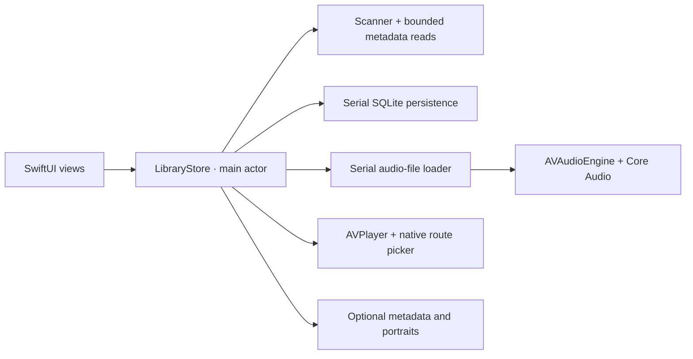

# Prisma Music

[](https://github.com/josue758/PrismaMusic/actions/workflows/ci.yml)
[](LICENSE)

A native macOS music player for local collections and mounted NAS libraries. Built with Swift, SwiftUI, AVAudioEngine and Core Audio, with an artwork-driven Liquid Glass interface.

**Apple Silicon · macOS 26+ · Beta 0.11.1**

[Download the app](https://github.com/josue758/PrismaMusic/releases/tag/v0.11.1) · [Guía en español](docs/USER_GUIDE.es.md) · [Architecture](docs/ARCHITECTURE.md) · [Validation evidence](VALIDACION.md)

## Try it

Download the DMG, drag **Prisma Music** to Applications, and open it. The welcome flow lets you choose Spanish, English or Portuguese, appearance and a music folder. Three redistributable instrumental demos are included; a NAS is optional.

The beta is ad hoc signed. It does not yet have Apple Developer ID signing or notarization. A [local signing/notarization workflow](docs/NOTARIZATION.md) is prepared and requires the owner’s Apple Developer membership and signing assets. No account or subscription is required. Updates preserve the library and preferences.

## Listening and browsing

- Browse songs, albums and artists; filter by artist, genre and year. Album pages show their songs with disc/track ordering when the files provide it.
- Inspect the real codec/container, bitrate estimate, file size, sample rate, channel count and bit depth.
- Choose a Core Audio output or DAC. Direct output bypasses application DSP and requests the source sample rate; exclusive access is optional and device dependent.
- Open an independent full-screen listening window with artwork, transport and synchronized lyrics. Closing it returns to the unchanged library.
- Look up original lyrics across scripts with canonical Unicode normalization, search fallbacks and strict artist/duration/performance checks.
- Show Apple on-device Spanish translation beneath the original lyrics. Supported language models can be downloaded with the system prompt; unsupported languages keep the original.
- Use the native AirPlay picker, a floating mini player, lyrics, a visualizer, playlists, favorites and listening history.
- Discover attributed artist photographs and biographies from Wikipedia/Wikimedia, choose a portrait and keep that choice locally.
- Customize artwork-derived colors, glass, motion, EQ and listening behavior. Reduced motion and reduced transparency are respected.
- Browse song rows with **↑ / ↓**, play the selection with **Return**, find music with **⌘F**, and leave search with **Esc**. **⌘I** inspects the selection.

## Engineering decisions

| Concern | Implementation and tradeoff |
| --- | --- |
| Slow network storage | Directory enumeration and bounded metadata workers run away from the UI. Incomplete scans do not prune the collection. SMB calls can still take time to return. |
| Rapid playback changes | A serial audio-file loader and request identity prevent a late result from replacing a newer selection. Cancelling discards the result without forcibly interrupting an OS call. |
| Large libraries | SQLite WAL, incremental writes, coalesced snapshots and shared external artwork avoid rewriting an entire JSON library or duplicating embedded covers. |
| Listening fidelity | A dedicated direct graph skips EQ, balance, rate changes and application attenuation. Tests check PCM sample equality internally; this is not physical DAC certification. |
| Image loading | ImageIO downsampling, serial portrait loading, cancellation and bounded caches limit avoidable image work. Vision considers faces when framing portraits. |
| Privacy | Audio stays local. Online features send search metadata, not audio or NAS credentials. They can be disabled; source files are never retagged by library edits. |



The app has no third-party Swift package dependencies. See [architecture and tradeoffs](docs/ARCHITECTURE.md) for isolation boundaries, persistence and current technical debt.

## Build and verify

Requires Xcode 26+ / Swift 6.2+ with the macOS 26 SDK or newer. The package currently uses Swift 5 language mode; strict Swift 6 concurrency migration is still planned.

```bash
git clone https://github.com/josue758/PrismaMusic.git
cd PrismaMusic
swift test
./scripts/build.sh
open "build/Prisma Music.app"
```

To run the same offline validation as CI, including a release build, signature check and DMG integrity verification:

```bash
./scripts/verify.sh
```

**80 tests** currently cover persistence and migration, scan cancellation, metadata parsing, playback races, offline DSP, direct PCM output, album identity, keyboard selection and artist-photo data. Ten integration tests are opt-in; CI skips them so it does not require your network, NAS or audio hardware. All 80 tests passed locally with external resources enabled, including real Japanese/Portuguese lyric lookups and native English/Japanese translation; see [validation](VALIDACION.md) for the exact scope.

GitHub Actions runs this check on the standard [macOS 26 Apple Silicon runner](https://docs.github.com/en/actions/reference/runners/github-hosted-runners), with read-only repository permissions and actions pinned to commit IDs. Each run retains its log and installer for 14 days.

## Scope and next steps

This is an actively developed beta. It has been exercised against a real SMB library with 7,854 listed files; 7,813 were imported and 41 original-file issues were reported. This is evidence for that collection, not a guarantee for every NAS or format.

Physical receiver AirPlay transfer, physical DAC bit-perfect output, Intel distribution, Developer ID signing and notarization remain unverified or unfinished. State coordination is still concentrated in `LibraryStore`; separating playback and import coordinators and adopting strict concurrency are the next architectural steps. See [the roadmap](docs/ROADMAP.md).

[Contributing](CONTRIBUTING.md) · [Changelog](CHANGELOG.md) · [MIT license](LICENSE)
